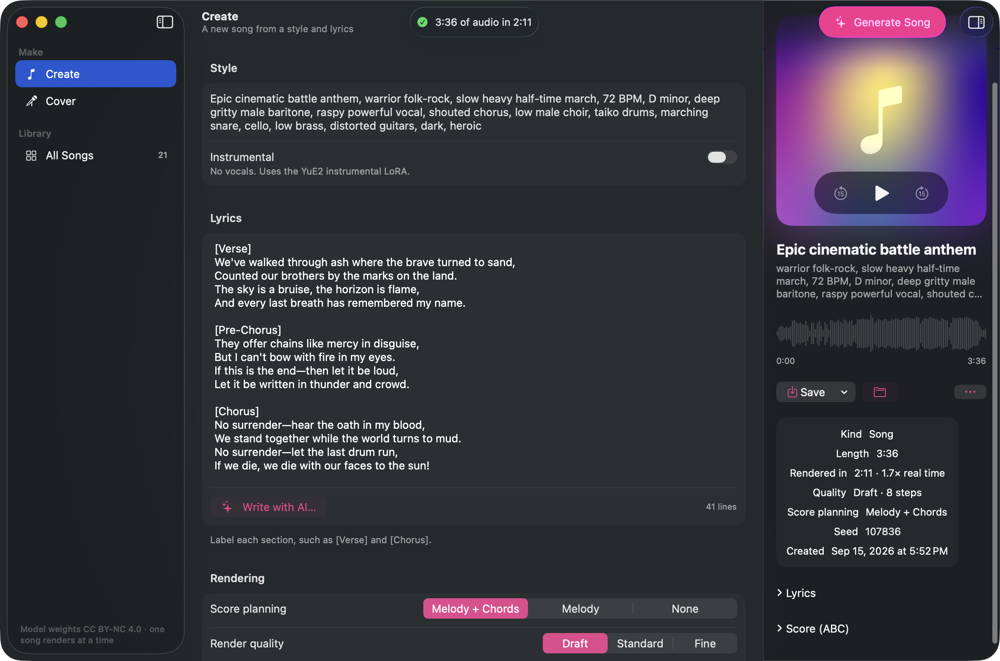

# yue2-mac



Native macOS front end for [m-a-p/YuE2-3B](https://huggingface.co/m-a-p/YuE2-3B) song generation,
mirroring the controls of the Hugging Face Space (`~/Views/yue2-3b/app.py`):

- **Create** — Style, Lyrics (with a "Write with AI…" popover: idea / language / structure / seed),
  Score planning (Melody + Chords · Melody · None), Render quality (Draft 8 · Standard 16 · Fine 32),
  Seed, Generate (⌘↩). Examples prefill the form.
- **Instrumental** (Create tab switch) — replaces Lyrics with an optional section plan
  (`[intro]` / `[verse]` / `[chorus]` / `[bridge]` / `[outro]`, optionally timed like `[verse 0:15-0:45]`;
  empty = `[instrumental]`, the model picks structure and length) and folds the
  [YuE2 instrumental AR LoRA](https://huggingface.co/Mothersuperior/YuE2-instrumental-cot-full-loras)
  into the AR weights at load time (`python3 mlxmgr.py install yue2-instrumental-lora`). Without the LoRA
  the base model gets tag-only lyrics, which does not guarantee zero vocals.
  Measured (8 steps): bare `[instrumental]` and untimed `[intro]…[outro]` both planned 184–210 bars
  (~9 min) and were cut at the 6-min semantic cap; a timed plan ending at 2:30 gave 164.6 s, ended
  naturally, in 84 s. The app therefore pre-fills the timed plan.
- **Cover** — Source song, lyrics language, "1. Transcribe melody + lyrics", New style,
  Matched lyrics, Melody ABC, Seed, Render quality, "2. Generate cover".

## Interface

Laid out to the macOS Human Interface Guidelines for macOS 26:

- **NavigationSplitView** — sidebar (Make: Create, Cover · Library: All Songs with a live count),
  a grouped `Form` in the detail column, and a trailing **inspector** with the artwork, transport,
  waveform, save actions, run details and the ABC score.
- **Toolbar** — the running job's stage and elapsed time in the centre, one prominent Generate
  action (⌘↩) that becomes Cancel (⌘.) while rendering, plus the inspector toggle. While a job runs
  the inspector shows a four-stage timeline (compose score → tokens → synthesize → decode) with live
  token counts and step progress.
- **Library** — every folder in `~/Library/Application Support/YuE2/outputs` as a card grid with
  search and All / Songs / Instrumentals / Covers scopes; play, Remix in Create, Make a Cover,
  Show in Finder and Move to Trash from the context menu.
- **Artwork is generated, not stored**: a `MeshGradient` seeded from the song's style and seed, so a
  song always keeps the same cover. The transport pill over the artwork is the only custom Liquid
  Glass element — the sidebar, toolbar and inspector use the system's own.
- Commands: ⌘1/⌘2/⌘3 switch panes, Space plays or pauses, ⇧⌘S saves FLAC, ⇧⌘R shows in Finder.
  Motion and transparency follow the accessibility settings.

Requires macOS 26 — the package targets `.macOS(.v26)` with Swift tools 6.2.

## Architecture

```
YuE2.app (SwiftUI) ──HTTP──> server/server.py  (FastAPI :8810, mlx-yue/.venv, MLX on Metal)
                    │           YuE2-3B (8-bit AR + BF16 NAR) + YuE2-Vae → generate / cover
                    │           SheetSage2 + MERT-v2-FullSong (MLX)       → melody ABC
                    └─HTTP──> omlx (:8000)
                                Qwen3-Omni   → "Write lyrics"
                                Whisper      → cover lyric transcription
```

The inference runtime is [vanch007/mlx-Yue](https://github.com/vanch007/mlx-Yue) (Apache-2.0),
a native MLX port that vendors the upstream `yue2` protocol code. The app launches the server itself
if nothing answers on :8810 (log: `~/Library/Logs/YuE2-server.log`) and stops it on quit. Outputs are
kept in `~/Library/Application Support/YuE2/outputs/<timestamp>/` (song.flac, song.mp3, score.abc,
lyrics, style, timing.json).

Lyrics writing and ASR use omlx instead of the Space's Qwen3-4B / Qwen3-ASR, so start the omlx
server for those two buttons; generation works without it.

## Setup

```bash
cd ~/Views/llm
# weights (upstream checkpoints into the HF cache)
python3 mlxmgr.py install yue2-3b
python3 mlxmgr.py install yue2-vae
python3 mlxmgr.py install sheetsage2
python3 mlxmgr.py install mert-v2-fullsong

# MLX runtime (Python 3.12). `uv sync` removes extra packages, so re-add the server deps after it.
git clone https://github.com/vanch007/mlx-Yue mlx-yue
cd mlx-yue
uv sync --frozen --no-dev --extra transcription
uv pip install --python .venv/bin/python fastapi uvicorn python-multipart

# convert the cached upstream checkpoint to MLX (offline, ~10 s)
HF_HUB_OFFLINE=1 .venv/bin/python -c "
import mlx.core, glob, os
from lyra.conversion import prepare
from lyra.measure import GPUExecution
src = glob.glob(os.path.expanduser('~/.cache/huggingface/hub/models--m-a-p--YuE2-3B/snapshots/*'))[0]
with GPUExecution(backend='mlx', memory_budget_gib=16, require_ac=False):
    print(prepare(src, 'models/converted', precision='8bit'))"
```

The server passes the cached YuE2-Vae snapshot path directly: mlx-Yue pins a newer VAE revision
whose weights are byte-identical, and resolving that revision offline would fail.
`YUE2_MLX_PRECISION=bf16` switches the AR model to BF16 (`ar-bf16.safetensors` is produced too).

Behind Netskope the large `model.safetensors` files are blocked for CLI downloads. Download them in a
browser, check sha256 against each repo's `weights_manifest.json`, move each to
`~/.cache/huggingface/hub/models--<org>--<name>/blobs/<sha256>`, symlink
`snapshots/<commit>/model.safetensors -> ../../blobs/<sha256>`, write `<commit>` to `refs/main`,
then run `mlxmgr.py install` to fetch the small files.

The original PyTorch/MPS env (`.venv-yue2`, yue2_infer wheel) still works with older copies of
`server.py`, but it is roughly 5× slower on long songs.

## Build / run

```bash
cd ~/Views/llm/yue2-mac
osascript -e 'quit app "YuE2"'; CONFIG=release ./build.sh && open YuE2.app
```

## Measured on M5 Max

| backend | request | audio | wall | breakdown |
|---|---|---|---|---|
| torch MPS BF16 | no score, 16 steps | 82 s | 111 s | semantic 26.8 tok/s, NAR 30 s |
| torch MPS BF16 | melody + chords, 16 steps | 71 s | 103 s | ABC 47 tok/s, semantic 38 tok/s |
| torch MPS BF16 | 6-min song, full score | 360 s | ~30 min | reported by user |
| **MLX 8-bit** | same 6-min song, supplied score, 16 steps | 359 s | **375 s** | semantic 8,983 tok @ 92 tok/s (98 s), NAR 267 s, VAE 10 s |
| **MLX 8-bit** | same, 8 steps | 359 s | **237 s** | NAR 130 s |

Codec rate is 25 tokens per second of audio (used for the app's progress estimate).
Weights are CC BY-NC 4.0.
